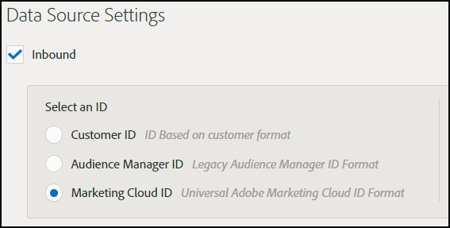

# Solução de problemas de configuração de destino {#destination-setup-troubleshooting}

Informações para ajudar a configurar destinos no Audience Manager e evitar problemas comuns.

## Eu configurei um destino, mas não vejo nenhum arquivo. Onde eles estão? {#destination-no-files}

<!-- c_dest_tshooting.xml -->

Problemas comuns de configuração de destino incluem os seguintes problemas:

### Destino configurado incorretamente

* **Chave [!UICONTROL UserID] incorreta:** A chave [!UICONTROL UserID] é o [!UICONTROL MasterDPID] desse destino e é a base para os valores de ID que serão ultrapassados. Mesmo que uma chave [!UICONTROL UserID] possa ser selecionada por meio da lista suspensa, isso não significa necessariamente que há IDs/características/segmentos mapeados para esse valor. Se o processo [!UICONTROL Outbound] (que é executado após a criação de destinos) não encontrar nenhum usuário mapeado para esta chave [!UICONTROL UserID], nenhum dado será limitado.
* **Não há Fontes de Dados de Arquivo Selecionadas:** Ao escolher qualquer tipo de destino diferente de [!UICONTROL S2S], uma seção aparece na parte inferior da tela rotulada [!UICONTROL Configure Data Sources]. Quando esta seção aparece pela primeira vez, nenhum valor é selecionado. Se você esquecer de clicar na caixa de seleção [!UICONTROL All First Party] ou selecionar fontes de dados individualmente na janela [!UICONTROL Available Data Sources], nenhum dado será extraviado.

### Formato configurado incorretamente

Ao selecionar um formato para seus dados de saída, é melhor, se possível, reutilizar um formato existente. O uso de um formato já comprovado garante que os dados de saída sejam gerados com êxito. Para ver exatamente como um formato existente está formatado, clique na opção [!UICONTROL Formats] na barra de menus e procure seu formato por nome ou por número de ID. Formatos ou macros malformados usados em formatos fornecerão saída formatada incorretamente ou impedirão que as informações sejam totalmente enviadas.

Para obter mais informações sobre como configurar formatos e usar macros, consulte [Macros de Formato de Arquivo](formats/file-formats.md#) e [Macros de Formato HTTP](formats/web-formats.md).

### Servidor configurado incorretamente

* **[!DNL FTP]**
   * **[!UICONTROL Domain]**
      * Não insira prefixos para nomes de host. Se você tiver uma conta [!DNL ftp://hello.com], basta digitar [!DNL hello.com] neste campo.
   * **[!UICONTROL Port/Type Combination]**
      * Para uma transferência [!DNL FTP], o tipo de transferência preferencial é [!DNL SFTP].
      * Ao selecionar o tipo [!DNL SFTP], a porta é quase sempre 22.
      * Ao selecionar o tipo [!DNL FTPs/TLS], a porta é quase sempre 21.
      * O tipo [!DNL FTPs/TLS] não é o mesmo que uma transferência [!DNL FTP] comum. Não oferecemos suporte a transferências [!DNL FTP] comuns (não seguras).
   * **[!UICONTROL Remote Path]**
      * Ao escolher um subcaminho remoto, ele deve ser inserido sem a barra à esquerda.
      * Se o arquivo transferido deve ser colocado na subpasta [!DNL (root)/inbound], basta adicionar [!DNL inbound] para o caminho remoto, não [!DNL /inbound].
      * Se você enviar seus arquivos para vários diretórios no caminho, insira barras entre cada diretório. Se você receber a localização de [!DNL /inbound/subdirectory1/subdirectory2], digite [!DNL inbound/subdirectory1/subdirectory2] neste campo.
      * Se o arquivo tiver que ser colocado no diretório roteado automaticamente para o pelo servidor externo, você pode deixar esse espaço em branco. Não insira um ponto final ( . ), barra ( / ) ou qualquer outra coisa.

* **[!DNL S3]**
   * [!DNL S3] é o protocolo de transferência preferencial (acima de [!DNL FTP] ou [!DNL HTTP]).
      * **[!UICONTROL Bucket]**
         * O nome do bucket deve ser listado sem barras, prefixos, sufixos, etc. Se você receber o endereço [!DNL s3://your-bucket], basta adicionar [!DNL your-bucket] a este campo.
      * **[!UICONTROL Directory]**
         * Deixe esse campo em branco, a menos que receba especificamente um subdiretório no qual os dados devem ser colocados. Se você receber o endereço [!DNL s3://your-bucket/your-subdirectory], digite [!DNL your-bucket] no campo [!UICONTROL Bucket] e [!DNL your-subdirectory] deve ser adicionado ao campo [!UICONTROL Directory]. Não adicione barras anteriores.
         * Se você tiver que percorrer vários diretórios pelo caminho, deverá usar barras como separadores. Portanto, um local de [!DNL s3://your-bucket/your-subdirectory1/your-subdirectory2] teria [!DNL your-bucket] no campo [!UICONTROL Bucket] e [!DNL your-subdirectory1/your-subdirectory2] inserido no campo [!UICONTROL Directory].
      * **[!UICONTROL Access / Secret Keys]**
         * Quando [!DNL TechOps] cria um bucket e fornece chaves de acesso/segredo a um consultor, essas credenciais geralmente são `READ-ONLY` credenciais que devem ser entregues ao cliente. Essas credenciais não devem ser inseridas nos campos [!UICONTROL Access / Secret Key], pois isso causará falha na transferência (porque essas credenciais são somente leitura, não graváveis). No caso em que [!DNL TechOps] cria um bucket e fornece credenciais, o consultor também deve solicitar um par de chaves do Adobe - NÃO FORNECIDO AO CLIENTE - que permitirá a gravação de arquivos nesse bucket. Essa chave deve ser adicionada nesses campos.

* **[!DNL HTTP]**
   * **[!UICONTROL Domain]**
      * Não inserir informações de prefixo para [!DNL HTTP] entradas. Se você tiver uma conta [!DNL https://superduper.com], digite [!DNL https://superduper.com] neste campo.
      * **[!UICONTROL URL Prefix]**
         * Ao adicionar um prefixo [!DNL URL], deixe a barra anterior desativada. Um endereço de [!DNL https://hello.com/r/x/y/z] deve ter [!DNL https://hello.com] inserido no campo [!UICONTROL Domain] e [!DNL r/x/y/z] inserido aqui no campo [!UICONTROL URL Prefix].
         * Se um [!UICONTROL URL Prefix] não for necessário, deixe este valor em branco.
      * **[!UICONTROL Authentication - SSH Key]**
         * Insira o valor completo da chave `SSH PRIVATE` nesta caixa, incluindo cabeçalhos, rodapés e quebras de linha para garantir uma criptografia/armazenamento de chave preciso.

### Não há tempo suficiente para a geração de saída

O processo de saída é executado duas vezes por dia e vários processos (saída, publicação, envio para locais externos etc.) devem ser executados antes de um arquivo ser enviado ao destino final. Uma boa regra geral é que um destino deve ser totalmente configurado pelo menos 24 horas antes de você poder esperar que os dados sejam enviados para um local externo.

### Tamanho de Divisão de Arquivo Muito Grande

Ao delimitar arquivos para destinos, você pode dividir arquivos de saída maiores em partes de arquivo. Certifique-se de que as partes individuais do arquivo não excedam 10 GB. Consulte também [Nome do Arquivo de Dados de Saída: Sintaxe e Exemplos](https://experienceleague.adobe.com/docs/audience-manager/user-guide/implementation-integration-guides/receiving-audience-data/batch-outbound-data-transfers/outbound-file-name-contents.html?lang=pt-BR).

## Como configurar seus destinos para exportar IDs da Experience Cloud, IDs do cliente ou IDs da Audience Manager em arquivos de dados de saída {#set-up-destinations-export}

Esta página mostra como configurar destinos para exportar dados com o tipo de ID que você deseja no [!UICONTROL Outbound Data Files].

<!-- set-up-destinations-mcid-aamid.xml -->

Os destinos permitem que nossos clientes ativem seus dados em qualquer número de canais digitais. Por exemplo, eles podem exportar dados de público-alvo para outras soluções do [!DNL Adobe Experience Cloud] ([!DNL Target], [!DNL Campaign] etc.). Ou eles podem enviar dados para [!UICONTROL DSP]s, [!UICONTROL SSP]s ou qualquer plataforma integrada ao Audience Manager. Mantemos uma lista de parceiros com os quais trabalhamos em nossa [página Wiki de Integrações](https://wiki.corp.adobe.com/display/MCPI).

>[!NOTE]
>
>Para obter uma apresentação detalhada sobre como criar destinos na interface do Administrador, consulte o artigo [Criar ou editar destinos da empresa](companies/admin-manage-company-destinations.md#create-edit-company-destinations).

Seus clientes desejam exportar tipos de ID diferentes, dependendo do destino. O gráfico de configuração abaixo mostra as opções que devem ser selecionadas para exportar informações de perfil relacionadas a diferentes tipos de ID. Recomendamos que você também consulte o [Índice de IDs no Audience Manager](https://experienceleague.adobe.com/docs/audience-manager/user-guide/reference/ids-in-aam.html?lang=pt-BR). Há três configurações importantes a serem consideradas: [!UICONTROL User ID Key], [!UICONTROL Data Source Type] e [!UICONTROL Format]. Detalhamos todos eles abaixo.

* [!UICONTROL User ID Key]. No [!UICONTROL Admin UI], vá para **[!UICONTROL Companies]**. Pesquise a empresa do cliente e clique nela. Procure a guia **[!UICONTROL Destinations]** e pressione **[!UICONTROL Add Destination]**. No fluxo de trabalho **[!UICONTROL Add Destination]**, selecione o [!UICONTROL User ID Key]. O [!UICONTROL User ID Key] filtrará as IDs de entrada da fonte de dados de destino e permitirá que apenas as IDs passem.

  

* [!UICONTROL Data Source Type]. Selecione essa opção ao criar um destino na interface do Audience Manager. Primeiro, selecione [!UICONTROL Inbound] e, em seguida, selecione o tipo de ID desejado. As opções são:

  

* [!UICONTROL Format]. Essa opção determina o formato de arquivo que será exportado. No fluxo de trabalho **[!UICONTROL Add Destination]**, em **[!UICONTROL Batch Data]**, selecione o formato.

Para inspecionar um formato, vá para **[!UICONTROL Admin UI > Formats]** e procure pelo elemento [!UICONTROL Data Row]. Esse elemento contém uma macro do formato de arquivo, &lt;MCID> no exemplo abaixo.

<table id="table_DAEE5BC75DCB4FC690C4BAE41F627DEC"> 
 <thead> 
  <tr> 
   <th colname="col01" class="entry"> Configuração nº </th> 
   <th colname="col1" class="entry"> 
Chave do usuário 
 </th> 
   <th colname="col2" class="entry"> 
Tipo de Source de dados 
 </th> 
   <th colname="col3" class="entry"> 
Formato 
 </th> 
   <th colname="col4" class="entry"> 
Tipo de ID exportado 
 </th> 
  </tr>
 </thead>
 <tbody> 
  <tr> 
   <td colname="col01"> 1 </td> 
   <td colname="col1"> 
Adobe Audience Manager (0) 
 </td> 
   <td colname="col2"> 
Experience Cloud ID 
 </td> 
   <td colname="col3"> 
&lt;DP_UUID&gt; 
 </td> 
   <td colname="col4"> 
Experience Cloud ID 
 </td> 
  </tr> 
  <tr> 
   <td colname="col01"> 2 </td> 
   <td colname="col1"> 
Adobe Audience Manager (0) 
 </td> 
   <td colname="col2"> 
Experience Cloud ID 
 </td> 
   <td colname="col3"> 
MCID 
 </td> 
   <td colname="col4"> 
UUID do Audience Manager 
 </td> 
  </tr> 
  <tr> 
   <td colname="col01"> 3 </td> 
   <td colname="col1"> 
Adobe Audience Manager (0) 
 </td> 
   <td colname="col2"> 
Experience Cloud ID 
 </td> 
   <td colname="col3"> 
UUID 
 </td> 
   <td colname="col4"> 
Experience Cloud ID 
 </td> 
  </tr> 
  <tr> 
   <td colname="col01"> 4 </td> 
   <td colname="col1"> 
Adobe Audience Manager (0) 
 </td> 
   <td colname="col2"> 
AUDIENCE MANAGER ID 
 </td> 
   <td colname="col3"> 
&lt;DP_UUID&gt; 
 </td> 
   <td colname="col4"> 
UUID do Audience Manager 
 </td> 
  </tr> 
  <tr> 
   <td colname="col01"> 5 </td> 
   <td colname="col1"> 
Adobe Audience Manager (0) 
 </td> 
   <td colname="col2"> 
AUDIENCE MANAGER ID 
 </td> 
   <td colname="col3"> 
MCID 
 </td> 
   <td colname="col4"> 
Experience Cloud ID 
 </td> 
  </tr> 
  <tr> 
   <td colname="col01"> 6 </td> 
   <td colname="col1"> 
Adobe Audience Manager (0) 
 </td> 
   <td colname="col2"> 
AUDIENCE MANAGER ID 
 </td> 
   <td colname="col3"> 
UUID 
 </td> 
   <td colname="col4"> 
UUID do Audience Manager 
 </td> 
  </tr> 
  <tr> 
   <td colname="col01"> 7 </td> 
   <td colname="col1"> 
DPID (qualquer fonte de dados à qual a empresa tenha acesso) 
 </td> 
   <td colname="col2"> 
Customer ID 
 </td> 
   <td colname="col3"> 
&lt;DP_UUID&gt; 
 </td> 
   <td colname="col4"> 
ID do cliente (DPUUID) 
 </td> 
  </tr> 
  <tr> 
   <td colname="col01"> 8 </td> 
   <td colname="col1"> 
DPID (qualquer fonte de dados à qual a empresa tenha acesso) 
 </td> 
   <td colname="col2"> 
Customer ID 
 </td> 
   <td colname="col3"> 
MCID 
 </td> 
   <td colname="col4"> 
Experience Cloud ID 
 </td> 
  </tr> 
  <tr> 
   <td colname="col01"> 9 </td> 
   <td colname="col1"> 
DPID (qualquer fonte de dados à qual a empresa tenha acesso) 
 </td> 
   <td colname="col2"> 
Customer ID 
 </td> 
   <td colname="col3"> 
UUID 
 </td> 
   <td colname="col4"> 
UUID do Audience Manager 
 </td> 
  </tr> 
  <tr> 
   <td colname="col01"> 10 </td> 
   <td colname="col1"> 
DPID (qualquer fonte de dados à qual a empresa tenha acesso) 
 </td> 
   <td colname="col2"> 
AUDIENCE MANAGER ID 
 </td> 
   <td colname="col3"> 
&lt;DP_UUID&gt; 
 </td> 
   <td colname="col4"> 
UUID do Audience Manager 
 </td> 
  </tr> 
  <tr> 
   <td colname="col01"> 11 </td> 
   <td colname="col1"> 
DPID (qualquer fonte de dados à qual a empresa tenha acesso) 
 </td> 
   <td colname="col2"> 
AUDIENCE MANAGER ID 
 </td> 
   <td colname="col3"> 
MCID 
 </td> 
   <td colname="col4"> 
Experience Cloud ID 
 </td> 
  </tr> 
  <tr> 
   <td colname="col01"> 12 </td> 
   <td colname="col1"> 
DPID (qualquer fonte de dados à qual a empresa tenha acesso) 
 </td> 
   <td colname="col2"> 
AUDIENCE MANAGER ID 
 </td> 
   <td colname="col3"> 
UUID 
 </td> 
   <td colname="col4"> 
UUID do Audience Manager 
 </td> 
  </tr> 
 </tbody> 
</table>

## Casos de uso

Digamos que você use o Audience Manager e [!DNL Campaign]. Para tornar os dados do cliente acionáveis em [!DNL Campaign], você deseja exportar [!UICONTROL Experience Cloud IDs]. Nesse caso, você deve usar a configuração número 3.
