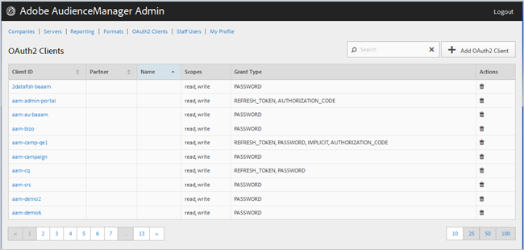

# Clientes OAuth2 {#oauth-clients}

Use a página [!UICONTROL OAuth2 Clients] para exibir uma lista de clientes do [!UICONTROL OAuth2] na sua configuração [!DNL Audience Manager]. É possível editar ou excluir clientes existentes ou criar novos clientes, contanto que você tenha as funções de usuário apropriadas atribuídas.

## Visão geral {#overview}

<!-- c_oauth.xml -->

>[!NOTE]
>
>Certifique-se de que o cliente leia a documentação do [OAuth2](https://experienceleague.adobe.com/docs/audience-manager/user-guide/api-and-sdk-code/rest-apis/aam-api-getting-started.html?lang=pt-BR#oauth) no Guia do Usuário do Audience Manager.

[!DNL OAuth2] é um padrão aberto para autorização para fornecer acesso delegado seguro aos recursos [!DNL Audience Manager] em nome de um proprietário de recurso.

Você pode classificar cada coluna em ordem crescente ou decrescente clicando no cabeçalho da coluna desejada.

Use a caixa [!UICONTROL Search] ou os controles de paginação na parte inferior da lista para encontrar o cliente desejado.

## Criar ou editar um cliente OAuth2 {#create-edit-client}

<!-- t_create_edit_auth.xml -->

Use a página [!UICONTROL OAuth2 Clients] na ferramenta [!UICONTROL Admin] do Audience Manager para criar um novo cliente [!UICONTROL Oauth2] ou editar um cliente existente.

1. Para criar um novo cliente [!UICONTROL OAuth2], clique em **[!UICONTROL OAuth2 Clients]** > **[!UICONTROL Add OAuth2 Client]**. Para editar um cliente [!UICONTROL OAuth2] existente, clique no cliente desejado na coluna **[!UICONTROL Client ID]**.
1. Especifique o nome desejado para este cliente [!UICONTROL OAuth2]. Observe que esse é um nome somente para o registro.
1. Especifique o email do cliente [!UICONTROL OAuth2]. Há um limite de um endereço de email.
1. Na lista suspensa **[!UICONTROL Partner]**, selecione o parceiro desejado.
1. Na caixa **[!UICONTROL Client ID]**, especifique a ID desejada. Este é o valor usado ao enviar [!DNL API] solicitações. O prefixo é preenchido automaticamente quando você começa a digitar depois de escolher um [!UICONTROL Partner] na lista suspensa na etapa anterior. O formato correto é &lt; *`partner subdomain`*> - &lt; *`Audience Manager username`*>.
1. Marque ou desmarque a caixa de seleção **[!UICONTROL Restrict to Partner Users]**, conforme desejado. Se esta caixa de seleção estiver marcada, o usuário deverá ser um [!DNL Audience Manager] usuário listado para o parceiro selecionado. Como prática recomendada, selecione essa opção.
1. Na seção **[!UICONTROL Scope]**, marque ou desmarque as caixas de seleção **[!UICONTROL Read]** e **[!UICONTROL Write]**, conforme desejado.
1. Na seção **[!UICONTROL Grant Type]**, selecione o meio de autorização desejado. Recomendamos que você use as configurações padrão das opções [!UICONTROL Password] e [!UICONTROL Refresh-token].

   * **[!UICONTROL Implicit]**: Se você selecionar esta opção, a caixa [!UICONTROL Redirect URI] será habilitada. O usuário recebe um token de acesso automático após ser autenticado e é enviado imediatamente para o redirecionamento [!DNL URI].
   * **[!UICONTROL Authorization Code]**: Se você selecionar esta opção, a caixa [!UICONTROL Redirect URI] será habilitada. O usuário é retornado ao cliente após ser autenticado e enviado para o redirecionamento [!DNL URI].
   * **[!UICONTROL Password]**: o usuário é autenticado com uma senha digitada pelo usuário em vez de uma tentativa de validação automática através de um servidor de autorização.
   * **[!UICONTROL Refresh_token]**: usado para atualizar um token de acesso expirado por um período de tempo estendido.

1. Na caixa **[!UICONTROL Redirect URI]**, especifique a [!DNL URI] desejada. Esta opção só estará habilitada se você selecionar os tipos de concessão **[!UICONTROL Implicit]** e **[!UICONTROL Authorization_code]**. A caixa **[!UICONTROL Redirect URI]** permite especificar um valor separado por vírgulas de valores [!DNL URI] aceitáveis. Este é o [!DNL URI] para o qual um usuário de um cliente é redirecionado após aprovar o cliente para acesso de [!DNL API].
1. Especifique o tempo de expiração desejado (em segundos) para a expiração do token de acesso e atualização.

   * **[!UICONTROL Access Token Expiration Time]**: O número de segundos que um token de acesso é válido após ser emitido. Pode ser nulo para usar o padrão da plataforma (12 horas). Além disso, pode ser -1 para indicar que o token de acesso não expira.
   * **[!UICONTROL Refresh Token Expiration Time]**: O número de segundos que um token de atualização é válido após ser emitido. Pode ser nulo para usar o padrão da plataforma (30 dias).

1. Clique em **[!UICONTROL Save]**.

Para excluir um cliente [!UICONTROL OAuth2], clique em **[!UICONTROL OAuth2 Clients]** e em  na coluna **[!UICONTROL Actions]** para o cliente desejado.

>[!MORELIKETHIS]
>
>* [Requisitos da API e recomendações](../admin-oauth2/aam-admin-api-requirements.md)
