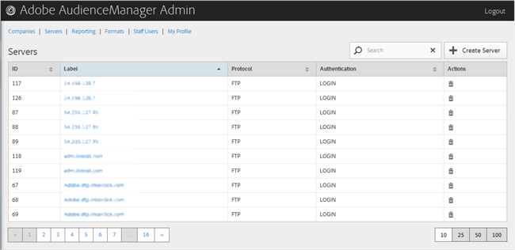

# Excluir um servidor {#delete-a-server}

Use a página [!UICONTROL Servers] na ferramenta de administração do Audience Manager para excluir um servidor existente.

<!-- t_delete_server.xml -->

>[!NOTE]
>
>Você deve ter a função [!UICONTROL DEXADMIN] para excluir servidores existentes.

1. Para excluir um servidor existente, clique em **[!UICONTROL Servers]**.

   

1. Clique em  na coluna **[!UICONTROL Actions]** do servidor desejado.
1. Clique em **[!UICONTROL OK]** para confirmar a exclusão.
