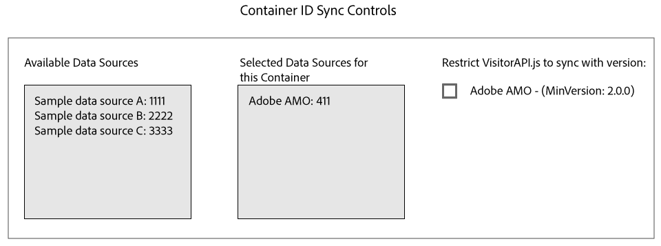

# Sincronização de ID com o Media Otimizer {#id-syncing-with-media-optimizer}

Por padrão, todas as empresas sincronizam dados com [!DNL Adobe Media Optimizer] ([!DNL AMO]). No [!UICONTROL Admin UI], cada container de empresa tem uma fonte de dados que gerencia esse processo. Esta fonte de dados é [!UICONTROL Adobe AMO] ([!UICONTROL ID] 411). Clique em uma linha de contêiner (na guia [!UICONTROL Containers]) de uma empresa selecionada para desabilitar esta sincronização padrão ou para adicionar e remover outras fontes de dados ao processo de sincronização [!DNL AMO].

## Status da sincronização de ID {#id-sync-status}

A tabela a seguir descreve o status de sincronização de uma fonte de dados.

| Status | Descrição |
|------ | -------- |
| Desligado | Remova todas as fontes de dados de [!UICONTROL Selected Data Sources] desse contêiner para desabilitar sincronizações de ID com [!DNL AMO] |
| Ativado (independentemente da versão do serviço de ID) | Uma fonte de dados é sincronizada com [!DNL AMO] independentemente da versão do serviço de ID quando: <ul><li>A fonte de dados aparece na lista [!UICONTROL Selected Data Sources].</li><li>A caixa de seleção *de [!DNL AMO] não está* marcada.</li></ul> |
| Ativado (independentemente da versão do serviço de ID) | Uma fonte de dados será sincronizada com [!DNL AMO] com o serviço de ID versão 2.0 (ou posterior) quando: <ul><li>A fonte de dados aparece na lista [!UICONTROL Selected Data Sources].</li><li>A caixa de seleção *is* de [!DNL AMO] está marcada.</li></ul> |

>[!MORELIKETHIS]
>
>* [Gerenciar containers](../companies/admin-manage-containers.md#task_61DB5CEECC5049DD8D059C642AC3F967)
