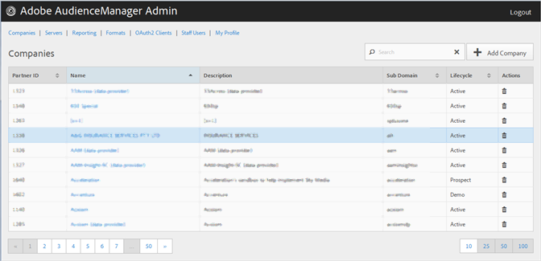

# Empresas {#companies}

Use a página [!UICONTROL Companies] para exibir uma lista de empresas na sua configuração do Audience Manager. É possível editar ou excluir empresas existentes ou criar novas empresas, desde que você tenha as funções de usuário apropriadas atribuídas.

Você pode classificar cada coluna em ordem crescente ou decrescente clicando no cabeçalho da coluna desejada.

Use a caixa [!UICONTROL Search] ou os controles de paginação na parte inferior da lista para encontrar a empresa desejada.
