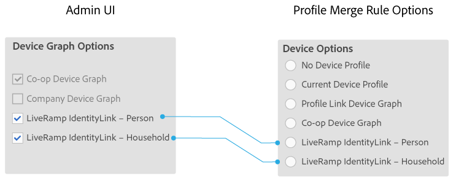

# Opções de gráfico de dispositivo para empresas {#device-graph-options-for-companies}

Os [!UICONTROL Device Graph Options] estão disponíveis para empresas que participam do [!DNL Adobe Experience Cloud Device Co-op]. Se um cliente também tiver uma relação contratual com um provedor de gráficos de dispositivos de terceiros que esteja integrado ao Audience Manager, esta seção mostrará opções para esse gráfico de dispositivos. Estas opções estão localizadas em [!UICONTROL Companies] > nome da empresa > [!UICONTROL Profile] > [!UICONTROL Device Graph Options].

Esta ilustração usa nomes genéricos para as opções de gráficos de dispositivos de terceiros. Na produção, esses nomes vêm do provedor de gráficos de dispositivos e podem variar do que é mostrado aqui. Por exemplo, as opções [!DNL LiveRamp] geralmente (mas nem sempre):

* Iniciar com &quot;[!DNL LiveRamp]&quot;
* Contém um nome do meio que varia
* Termina com &quot;[!UICONTROL - Household]&quot; ou &quot;[!UICONTROL -Person]&quot;

## Definição das Opções de Gráfico de Dispositivo {#device-graph-options-defined}

As opções de gráfico de dispositivos selecionadas aqui expõem ou ocultam as [!UICONTROL Device Options] opções disponíveis para um cliente do [!DNL Audience Manager] quando ele cria um [!UICONTROL Profile Merge Rule].

### Gráfico de dispositivos cooperativos {#co-op-graph}

Os clientes que participam do [Device Co-op](https://experienceleague.adobe.com/docs/device-co-op/using/about/overview.html?lang=en) da Adobe Experience Cloud usam essas opções para criar um [!UICONTROL Profile Merge Rule] com [dados determinísticos e probabilísticos](https://experienceleague.adobe.com/docs/device-co-op/using/device-graph/links.html?lang=en). O [!DNL Corporate Provisioning Team] ativa e desativa essa opção por meio de uma chamada [!DNL API] de back-end. Não é possível marcar ou desmarcar estas caixas em [!DNL Admin UI]. Além disso, as opções **[!UICONTROL Co-op Device Graph]** e **[!UICONTROL Company Device Graph]** são mutuamente exclusivas. Os clientes podem nos pedir para ativar um ou outro, mas não ambos. Quando marcado, expõe o controle **[!UICONTROL Co-op Device Graph]** nas configurações [!UICONTROL Device Options] para [!UICONTROL Profile Merge Rule].

### Gráfico de dispositivos da empresa {#company-graph}

Esta opção é para clientes do [!DNL Analytics] que usam a métrica [!UICONTROL People] em seus conjuntos de relatórios [!DNL Analytics]. O [!DNL Corporate Provisioning Team] ativa e desativa essa opção por meio de uma chamada [!DNL API] de back-end. Não é possível marcar ou desmarcar estas caixas em [!DNL Admin UI]. Além disso, as opções **[!UICONTROL Company Device Graph]** e **[!UICONTROL Co-op Device Graph]** são mutuamente exclusivas. Os clientes podem nos pedir para ativar um ou outro, mas não ambos. Quando marcado:

* Este gráfico de dispositivos usa dados determinísticos que pertencem à empresa que você está configurando (sem dados probabilísticos).
* [!DNL Audience Manager] cria automaticamente um [!UICONTROL Data Source] chamado `*`nome do parceiro`*-Company Device Graph-Person`. Na página de detalhes do [!UICONTROL Data Source], os clientes do [!DNL Audience Manager] podem alterar o nome e a descrição do parceiro e aplicar os [Controles da Exportação de Dados](https://experienceleague.adobe.com/docs/device-co-op/using/device-graph/links.html?lang=en) a essa fonte de dados.
* [!DNL Audience Manager] clientes *não* veem uma nova configuração na seção [!UICONTROL Device Options] para um [!UICONTROL Profile Merge Rule].

### Gráfico de dispositivos do LiveRamp (pessoa ou residência) {#liveramp-device-graph}

Estas caixas de seleção estão habilitadas no [!DNL Admin UI] quando um parceiro cria um [!UICONTROL Data Source] e seleciona **[!UICONTROL Use as an Authenticated Profile]** e/ou **[!UICONTROL Use as a Device Graph]**. Os nomes dessas configurações são determinados pelo provedor de gráficos de dispositivos de terceiros (por exemplo, [!DNL LiveRamp], [!DNL TapAd] etc.). Quando marcado, significa que a empresa que você está configurando usará os dados fornecidos por esses gráficos de dispositivos.

>[!MORELIKETHIS]
>
>* [Definição das opções da regra de mesclagem de perfis](https://experienceleague.adobe.com/docs/audience-manager/user-guide/features/profile-merge-rules/merge-rule-definitions.html?lang=en)
>* [Opções de Menu e Configurações do Data Source](https://experienceleague.adobe.com/docs/audience-manager/user-guide/features/data-sources/datasources-list-and-settings.html?lang=en)
