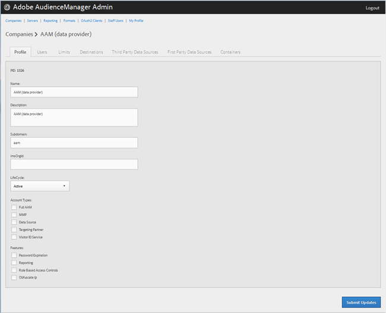

# Criar um perfil de empresa {#create-a-company-profile}

Use a página [!UICONTROL Companies] na ferramenta de administração do Audience Manager para criar uma nova empresa.

<!-- t_create_company.xml -->

>[!NOTE]
>
>Você deve ter a função **[!UICONTROL DEXADMIN]** para criar novas empresas.

1. Clique em **[!UICONTROL Companies]** > **[!UICONTROL Add Company]**.
1. Preencha os campos:

   * **[!UICONTROL Name]**: (Obrigatório) Especifique o nome da empresa.
   * **[!UICONTROL Description]**: (obrigatório) forneça informações descritivas sobre a empresa, como o setor ou seu nome completo.
   * **[!UICONTROL Subdomain]**: (Obrigatório) Especifique o subdomínio da empresa. O texto inserido é exibido como o subdomínio da chamada de evento. Isso não pode ser alterado. Deve ser uma cadeia de [!DNL URL] caracteres válidos.

     Por exemplo, se o nome da sua empresa fosse [!DNL AcmeCorp], o subdomínio seria [!DNL acmecorp].

     O Audience Manager usa o subdomínio para o [!UICONTROL Data Collection Server] (DCS). No exemplo anterior, se a [!DNL URL] completa da sua empresa em [!UICONTROL DCS] seria [!DNL acmecorp.demdex.net].

   * **[!UICONTROL Lifecyle]**: especifique o estágio desejado para a empresa:
      * **[!UICONTROL Active]**: especifique que a empresa será um cliente ativo do Audience Manager. Uma conta [!UICONTROL Active] significa um cliente pagante, não apenas para consultoria, mas para a SKU do Audience Manager.
      * **[!UICONTROL Demo]**: especifique que a empresa será somente para fins de demonstração. Os dados de relatórios serão automaticamente falsificados.
      * **[!UICONTROL Prospect]**: especifique que a empresa é um cliente potencial do Audience Manager, como uma empresa que está recebendo um [!DNL POC] gratuito ou uma configuração de conta para uma demonstração de vendas.
      * **[!UICONTROL Test]**: especifique que a empresa será apenas para fins de teste interno.

   * **[!UICONTROL Account Types]**: especifique o conjunto completo de tipos de conta para esta empresa. Nenhum tipo de conta é mutuamente exclusivo com qualquer outro tipo.
      * **[!UICONTROL Full AAM]**: especifique que a empresa terá uma conta completa do Adobe Audience Manager e que os usuários terão acesso de logon.
      * **[!UICONTROL MMP]**: especifique que a empresa foi habilitada para usar os recursos [!UICONTROL Master Marketing Profile] ([!UICONTROL MMP]). O [!UICONTROL MMP] permite que os públicos-alvo sejam compartilhados na Experience Cloud usando um [!UICONTROL Experience Cloud ID] ([!DNL MCID]) atribuído a cada visitante e, em seguida, usado pelo Audience Manager. Se você selecionar esse tipo de conta, o [!UICONTROL Experience Cloud ID Service] também será automaticamente selecionado.

        Para obter mais informações, consulte [Experience Cloud Audiences](https://experienceleague.adobe.com/docs/core-services/interface/services/audiences/audience-library.html?lang=en).

   * **[!UICONTROL Data Source]**: especifique que a empresa é um provedor de dados de terceiros no Audience Manager.
   * **[!UICONTROL Targeting Partner]**: especifique que a empresa atua como uma plataforma de direcionamento para clientes do Audience Manager.
   * **[!UICONTROL Visitor ID Service]**: especifique que a empresa foi habilitada para usar o [!UICONTROL Experience Cloud Visitor ID Service].

     O [!UICONTROL Experience Cloud Visitor ID Service] fornece uma ID de visitante universal em todas as soluções da Experience Cloud. Para obter mais informações, consulte o [guia do usuário do Serviço de ID de visitante da Experience Cloud](https://experienceleague.adobe.com/docs/id-service/using/intro/overview.html?lang=en).

   * **[!UICONTROL Agency]**: especifique que a empresa terá uma conta [!UICONTROL Agency].

1. Clique em **[!UICONTROL Create]**. Continue com as instruções em [Editar um Perfil de Empresa](../companies/admin-manage-company-profiles.md#edit-company-profile).

   

## Editar um perfil de empresa {#edit-company-profile}

Edite o perfil de uma empresa, incluindo nome, descrição, subdomínio, ciclo de vida e muito mais.

<!-- t_edit_company_profile.xml -->

1. Clique em **[!UICONTROL Companies]**, localize e clique na empresa desejada para exibir sua página [!UICONTROL Profile].

   Use a caixa [!UICONTROL Search] ou os controles de paginação na parte inferior da lista para encontrar a empresa desejada. Você pode classificar cada coluna em ordem crescente ou decrescente clicando no cabeçalho da coluna desejada.

   

1. Edite os campos conforme necessário:

   * **[!UICONTROL Name]**: Editar o nome da empresa. Este campo é obrigatório.
   * **[!UICONTROL Description]**: Editar a descrição da empresa. Este campo é obrigatório.
   * **[!UICONTROL Subdomain]**: (Obrigatório) Especifique o subdomínio da empresa. O texto inserido é exibido como o subdomínio da chamada de evento. Isso não pode ser alterado. Deve ser uma cadeia de [!DNL URL] caracteres válidos.

     Por exemplo, se o nome da sua empresa fosse [!DNL AcmeCorp], o subdomínio seria [!DNL acmecorp].

     O Audience Manager usa o subdomínio para o [!UICONTROL Data Collection Server] (DCS). No exemplo anterior, se a [!DNL URL] completa da sua empresa em [!UICONTROL DCS] seria [!DNL acmecorp.demdex.net].

   * **[!UICONTROL imsOrgld]**: ([!UICONTROL Identity Management System Organization ID]) essa ID permite que você conecte sua empresa à Adobe Experience Cloud.
   * **[!UICONTROL Lifecyle]**: especifique o estágio desejado para a empresa:
      * **[!UICONTROL Active]**: especifique que a empresa será um cliente ativo do Audience Manager. Uma conta ativa significa um cliente pagante, não apenas para consultoria, mas para a SKU do Audience Manager.
      * **[!UICONTROL Demo]**: especifique que a empresa será somente para fins de demonstração. Os dados de relatórios serão automaticamente falsificados.
      * **[!UICONTROL Prospect]**: especifique que a empresa é um cliente potencial do Audience Manager, como uma empresa que está recebendo um [!DNL POC] gratuito ou uma configuração de conta para uma demonstração de vendas.
      * **[!UICONTROL Test]**: especifique que a empresa será apenas para fins de teste interno.
   * **[!UICONTROL Account Types]**: especifique o conjunto completo de tipos de conta para esta empresa. Nenhum tipo de conta é mutuamente exclusivo com qualquer outro tipo.
      * **[!UICONTROL Full AAM]**: especifique que a empresa terá uma conta completa do Adobe Audience Manager e que os usuários terão acesso de logon.
      * **[!UICONTROL MMP]**: especifique que a empresa foi habilitada para usar os recursos do Perfil Mestre de Marketing ([!UICONTROL MMP]).

        Se você selecionar esse tipo de conta, **[!UICONTROL Visitor ID Service]** também será automaticamente selecionado.
Para obter mais informações, consulte [Experience Cloud Audiences](https://experienceleague.adobe.com/docs/core-services/interface/services/audiences/audience-library.html?lang=en).

   * **[!UICONTROL Data Source]**: especifique que a empresa é um provedor de dados de terceiros no Audience Manager.
   * **[!UICONTROL Targeting Partner]**: especifique que a empresa atua como uma plataforma de direcionamento para clientes do Audience Manager.
   * **[!UICONTROL Visitor ID Service]**: especifique que a empresa foi habilitada para usar o Serviço de ID de Visitante da Experience Cloud.

     O serviço de ID de visitante da Experience Cloud fornece uma ID de visitante universal em todas as soluções da Experience Cloud. Para obter mais informações, consulte o [guia do usuário do Serviço da Experience Cloud ID](https://experienceleague.adobe.com/docs/id-service/using/home.html?lang=en).

   * **[!UICONTROL Agency]**: especifique que a empresa terá uma conta de Agência.
   * **[!UICONTROL Features]**: Selecione as opções desejadas:
      * **[!UICONTROL Password Expiration]**: define todas as senhas de usuário nesta empresa para expirar após 90 dias para aumentar a segurança do Audience Manager.
      * **[!UICONTROL Reporting]**: Habilita os relatórios do Audience Manager para esta empresa.
      * **[!UICONTROL Role Based Access Controls]**: Habilitar controles de acesso baseados em função para esta empresa. Os controles de acesso com base em função permitem criar grupos de usuários com permissões de acesso diferentes. Os usuários individuais nesses grupos podem acessar apenas recursos específicos no Audience Manager.

1. Clique em **[!UICONTROL Submit Updates]**.

## Excluir um perfil de empresa {#delete-company-profile}

Use a página [!UICONTROL Companies] na ferramenta [!UICONTROL Admin] do Audience Manager para excluir uma empresa existente.

<!-- t_delete_company.xml -->

>[!NOTE]
>
>Você deve ter a função [!UICONTROL DEXADMIN] para excluir empresas existentes.

1. Para excluir uma empresa existente, clique em **[!UICONTROL Companies]**.

   

1. Clique em  na coluna **[!UICONTROL Actions]** da empresa desejada.
1. Clique em **[!UICONTROL OK]** para confirmar a exclusão.
