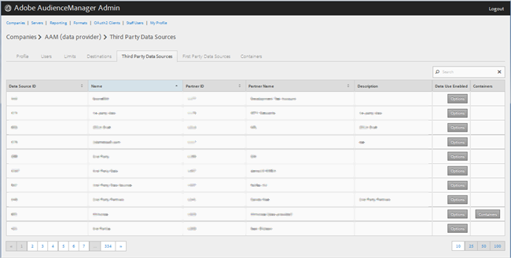
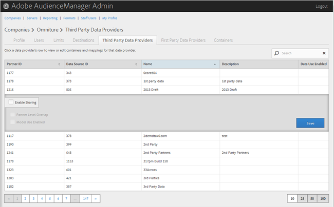

# Gerenciar provedores de dados de terceiros {#manage-third-party-data-providers}

Exibir ou editar containers e mapeamentos para provedores de dados de terceiros. Você também pode ativar o compartilhamento com diferentes provedores de dados.

1. Clique em **[!UICONTROL Companies]**, localize e clique na empresa desejada para exibir sua página [!UICONTROL Profile].

   Use a caixa [!UICONTROL Search] ou os controles de paginação na parte inferior da lista para encontrar a empresa desejada. Você pode classificar cada coluna em ordem crescente ou decrescente clicando no cabeçalho da coluna desejada.
1. Clique na guia **[!UICONTROL Third Party Data Providers]**.

   

1. Clique na linha de um provedor de dados para exibir ou editar containers e mapeamentos para esse provedor de dados.

   

1. Selecione **[!UICONTROL Enable Sharing]** para habilitar as seguintes opções:

   * **Sobreposição no Nível do Parceiro:**
   * **Uso do Modelo Habilitado:** Permite que esta empresa use este provedor de dados ao criar modelos algorítmicos.

   Ao habilitar o compartilhamento, você obtém acesso às características desse provedor de dados.

1. (Condicional) Se o container for ativado para esse provedor, você poderá selecionar containers para esse provedor de dados movendo os containers desejados da lista disponível para a lista selecionada.

   Você também pode executar esta tarefa a partir da página [Contêineres](../companies/admin-manage-containers.md#task_61DB5CEECC5049DD8D059C642AC3F967).
1. Clique em **[!UICONTROL Save]** se você tiver feito alterações.
