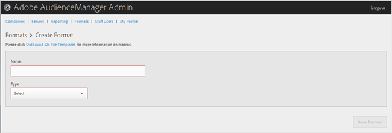

# Criar ou editar um formato {#create-or-edit-a-format}

Use a página [!UICONTROL Formats] na ferramenta de administração do Audience Manager para criar um novo formato ou editar um formato existente.

<!-- t_create_format.xml -->

>[!TIP]
>
>Ao selecionar um formato para seus dados de saída, é melhor, se possível, reutilizar um formato existente. O uso de um formato já comprovado garante que os dados de saída sejam gerados com êxito. Para ver exatamente como um formato existente está formatado, clique na opção [!UICONTROL Formats] na barra de menus e procure seu formato por nome ou por número de ID. Formatos ou macros malformados usados em formatos fornecerão saída formatada incorretamente ou impedirão que as informações sejam totalmente enviadas.

1. Para criar um novo formato, clique em **[!UICONTROL Formats]** > **[!UICONTROL Add Format]**. Para editar um formato existente, clique no formato desejado na coluna **[!UICONTROL Name]**.

   

1. Preencha os campos:
   * **Nome:** (obrigatório) forneça um nome descritivo para o formato.
   * **Tipo:** (Obrigatório) Selecione o formato desejado:
      * **[!UICONTROL File]**: Envia dados via [!DNL FTP] arquivos.
      * **[!UICONTROL HTTP]**: Delimita os dados em um wrapper [!DNL JSON].

1. (Condicional) Se você escolher **[!UICONTROL File]**, preencha os campos:

   >[!NOTE]
   >
   >Para obter uma lista de macros disponíveis, consulte [Macros de formato de arquivo](../formats/file-formats.md#concept_A867101505074418A58DE325949E5089) e [Macros de formato HTTP](../formats/web-formats.md#reference_C392124A5F3F42E49F8AADDBA601ADFE).

   * **[!UICONTROL File Name]:** Especifique o nome do arquivo de transferência de dados.
   * **Cabeçalho:** Especifique o texto que aparece na primeira linha do arquivo de transferência de dados.
   * **[!UICONTROL Data Row]:** Especifique o texto que aparece em cada linha de saída do arquivo.
   * **[!UICONTROL Maximum File Size (In MB)]:** Especifique o tamanho máximo de arquivos para transferência de dados. Os arquivos compactados devem ter menos de 100 MB. Não há limite para o tamanho do arquivo descompactado.
   * **[!UICONTROL Compression]:** Selecione o tipo de compactação desejado: gz ou zip para seus arquivos de dados. Para entrega em [!UICONTROL AWS S3], você deve usar arquivos .gz ou descompactados.
   * **[!UICONTROL .info Receipt]:** Especifica que um arquivo de controle de transferência ([!DNL .info]) é gerado. O arquivo [!DNL .info] fornece informações de metadados sobre transferências de arquivos para que os parceiros possam verificar se o Audience Manager tratou as transferências de arquivos corretamente. Para obter mais informações, consulte [Arquivos de Controle de Transferência para Transferências de Arquivos de Log](https://experienceleague.adobe.com/docs/audience-manager/user-guide/implementation-integration-guides/receiving-audience-data/batch-outbound-data-transfers/transfer-control-files.html?lang=en).
   * **[!UICONTROL MD5 Checksum Receipt]:** Especifica que um recibo de soma de verificação [!DNL MD5] é gerado. O recibo de soma de verificação [!DNL MD5] para que os parceiros possam verificar se a Audience Manager tratou corretamente a transferência completa.

1. (Condicional) Se você escolher **[!UICONTROL HTTP]**, preencha os campos:

   * **[!UICONTROL Method]:** Escolha o método [!DNL API] que deseja usar para o processo de transferência:
      * **[!UICONTROL POST]:** Se você selecionar [!DNL POST], selecione o tipo de conteúdo ([!DNL XML] ou [!DNL JSON]) e especifique o corpo da solicitação.
      * **[!UICONTROL GET]:** Se você selecionar [!DNL GET], especifique os parâmetros de consulta.

1. Clique em **[!UICONTROL Create]** se estiver criando um novo formato ou clique em **[!UICONTROL Save Updates]** se estiver editando um formato existente.

## Excluir um formato {#delete-format}

1. Clique em **[!UICONTROL Formats]**.
2. Clique em  na coluna **[!UICONTROL Actions]** do formato desejado.
3. Clique em **[!UICONTROL OK]** para confirmar a exclusão.
